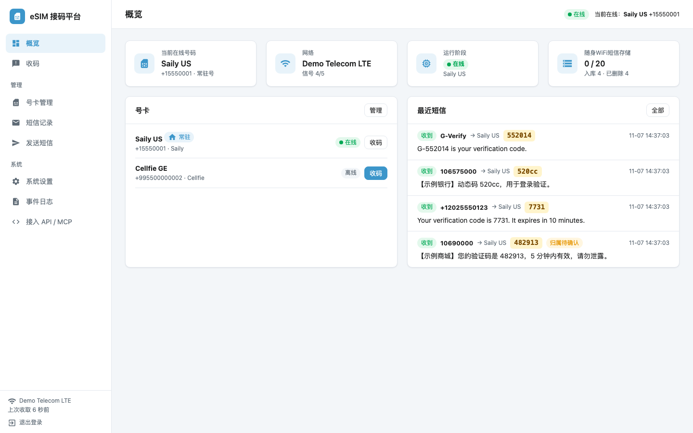
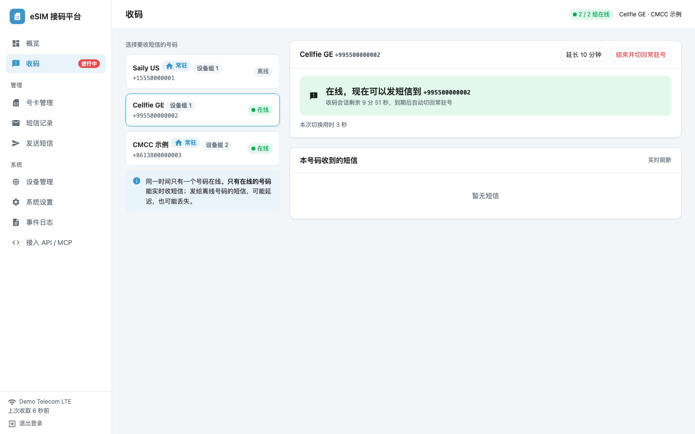
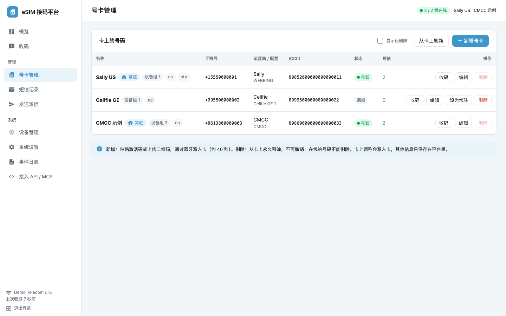
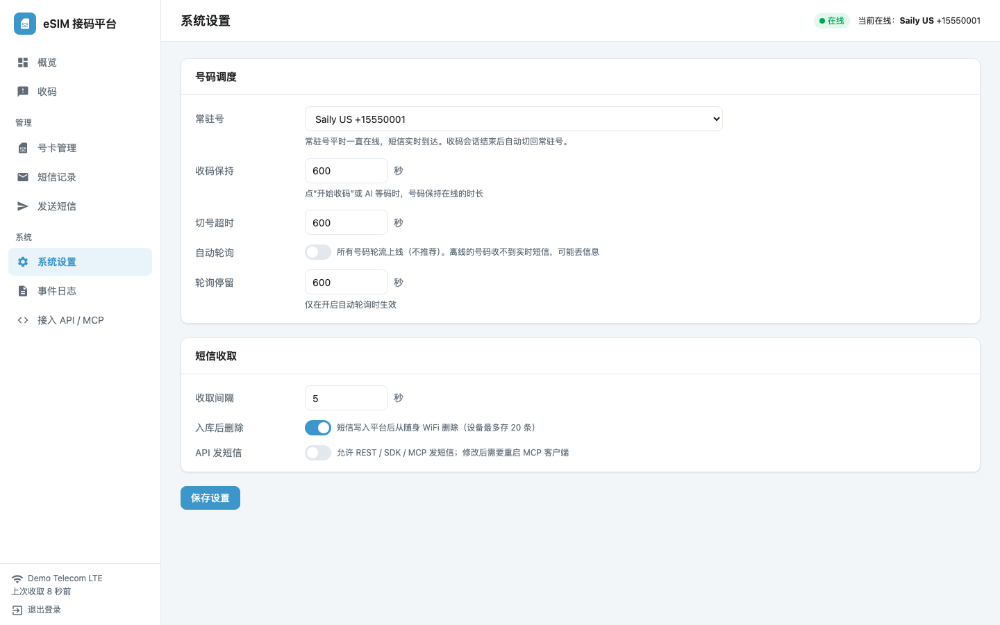

# esim-ble

在 Mac 上通过蓝牙管理 9eSIM 卡上的 eSIM 号码，并通过 USB 随身 WiFi 收发短信；还带一个**本地接码平台**（网页后台 + REST + Python SDK + MCP），让 AI 能用你自己的号码收验证码。

| 概览 | 收码 |
|---|---|
|  |  |
| **号卡管理** | **系统设置** |
|  |  |

> 截图来自 `scripts/demo_server.py`，数据都是虚构的。没有硬件也可以先运行它看看界面：`.venv/bin/python scripts/demo_server.py`，然后打开 http://127.0.0.1:8788/login?token=demo 。

- **卡管理（蓝牙）：** 查看、安装（激活码或二维码）、启用、停用、改名、删除卡上的号码。不用手机，也不用读卡器。
- **短信（随身 WiFi）：** 查看网络状态，读取收件箱（区分收发方向），发送单条短信，并能控制随身 WiFi：重启、开关 WiFi 热点、执行 AT 指令。
- **两种用法：** 命令行 `esimble`，或者在 Python 里调用 `CardService`、`Mifi`。
- **自包含：** 代码和虚拟环境都在本目录内，不依赖其他项目。

## 硬件

| 设备 | 说明 |
|---|---|
| 9eSIM 卡 | 卡上集成 BLE，蓝牙名形如 `9eSIMxxxxxx`（每张卡不同，用 `esimble config --ble-device` 设置成你卡上的名字）；插在随身 WiFi 或手机的 SIM 卡槽里供电 |
| 友猫 4G 随身 WiFi mini | 内部型号 SZXF MF761W，ZX297520V3 方案（ZTE goform 网页接口）；USB 接 Mac（CDC ECM 网卡），管理地址 `192.168.0.1`，后台默认密码 `admin` |
| Mac | macOS + CoreBluetooth，Python ≥ 3.10 |

## 快速开始

```sh
git clone https://github.com/CivetWyan/esim-ble.git && cd esim-ble
python3 -m venv .venv && .venv/bin/pip install -r requirements-platform.txt
.venv/bin/python -m esimble config --ble-device 9eSIMxxxxxx   # 你卡上的蓝牙名
.venv/bin/python -m esimble config --mifi-password            # 随身 WiFi 后台密码，默认 admin

.venv/bin/python -m esimble card list                  # 卡上有哪些号码
.venv/bin/python -m esimble card enable <ICCID>        # 启用一个号码
.venv/bin/python -m esimble mifi reboot -y             # 切号后重启随身 WiFi（见下）
.venv/bin/python -m esimble mifi sms-ready             # 等到显示 ready
.venv/bin/python -m esimble mifi inbox --direction in  # 看收到的短信
```

> 卡插在随身 WiFi 里时，每次切换号码后都要重启一次随身 WiFi，短信模块才会正常工作。原因和实测数据见 [docs/03-操作流程.md](docs/03-操作流程.md)。

## 文档

| 文档 | 内容 |
|---|---|
| [01 安装与配置](docs/01-安装与配置.md) | 环境、蓝牙权限、配置项、TLS 说明 |
| [02 命令行参考](docs/02-命令行参考.md) | 每个命令的参数、输出示例、注意事项 |
| [03 操作流程](docs/03-操作流程.md) | 装新号、切号收短信、删号、首次接入随身 WiFi 等完整步骤 |
| [04 Python 接口](docs/04-Python接口.md) | `CardService`、`Mifi`、`Database` 及底层模块的 API |
| [05 数据存储](docs/05-数据存储.md) | 配置文件、SQLite 表结构、日志 |
| [06 故障排查](docs/06-故障排查.md) | 常见现象、原因、处理方法和诊断命令 |
| [07 测试与验证记录](docs/07-测试与验证记录.md) | 离线测试清单和实测记录 |

## 当前状态（2026-11-07）

| 功能 | 状态 |
|---|---|
| 读卡、装卡、启用、停用、改名、删除 | 已实测通过 |
| 随身 WiFi：状态、收件箱、短信模块状态、WiFi 开关、AT 指令 | 已实测通过 |
| 卡在随身 WiFi 里：蓝牙切号 → 重启 → 收短信 | 已实测通过 |
| 随身 WiFi：发短信 | 已实现，未实测（测试卡没有开通短信发送） |
| 随身 WiFi：`mifi reboot` 命令 | 底层重启接口已实测；这个命令本身未在设备上运行 |
| 离线测试 | 18 个，全部通过 |

## 代码结构

```
esimble/
  card/            9eSIM 卡协议栈
    transport.py     ApduTransport 接口 + 测试用 ReplayTransport
    nble.py          BLE 传输：扫描、连接、鉴权、eUICC 模式、NBLE 分帧
    tlv.py           BER-TLV 编解码
    euicc.py         ES10：ISD-R 逻辑通道、STORE DATA、读卡、下载、配置管理
    es9p.py          ES9+：与 SM-DP+ 的 HTTPS 交互
    download.py      激活码解析 + 完整下载安装流程
  card_service.py  串行化的卡操作，结果同步到数据库
  mifi.py          随身 WiFi 客户端
  config.py        配置读写
  db.py            SQLite 存储
  cli.py           命令行入口
tests/             离线测试（不需要硬件）
docs/              详细文档
data/              配置和数据库（运行后生成，不入库）
logs/              运行日志（运行后生成，不入库）
```

## 参考资料

- [GSMA SGP.22](https://www.gsma.com/solutions-and-impact/technologies/esim/gsma_resources/)：eSIM 远程配置（消费级）规范
- NekokoLPA：9eSIM 蓝牙传输（NBLE）格式参考了其公开实现
- 协议分析的原始笔记含个人设备信息，未放进仓库

## 接码平台（2026-11-07 新增）

在上面的功能之上，加了一个常驻服务：网页后台、REST 接口、Python SDK 和 MCP。详见 [08 接码平台](docs/08-接码平台.md)。

```sh
.venv/bin/pip install -r requirements-platform.txt
.venv/bin/python -m esimble.platform serve        # 启动后台、接口和调度
.venv/bin/python -m esimble.platform token        # 查看登录链接和令牌
.venv/bin/python -m esimble.platform mcp-config   # 生成 Claude Code、Cursor、Codex 的 MCP 配置
```

- **调度：** 常驻号（Saily）一直在线；其他号码在后台"收码"页或通过 AI 按需切换，约 40 秒，用完自动切回常驻号。
- **存储：** 短信入库到 `data/esimble.db` 后，从随身 WiFi 删除（设备最多存 20 条）。
- **不要混用：** 平台运行时，不要再用 `esimble card` 或 `esimble mifi` 手动操作卡和随身 WiFi。
- **代码位置：** `esimble/platform/`，测试 `tests/test_platform.py`，MCP 自检脚本 `scripts/mcp_smoke.py`。

## 许可证

[MIT](LICENSE)，随便用。
